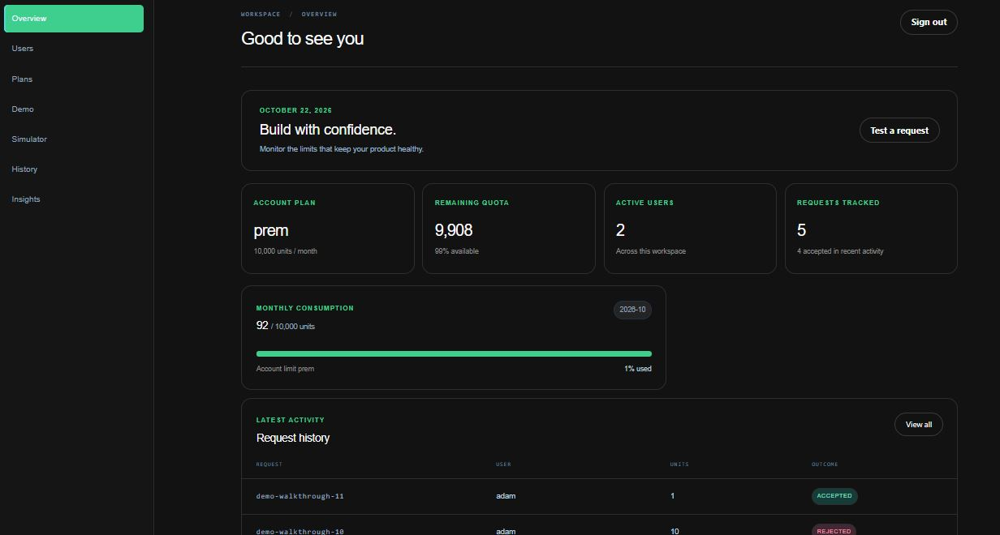

# Quota-Core

A backend service that other applications call to **meter usage of a single resource ("units") and decide whether one of
their users may perform an action**. Every request is checked against two plans at once: the calling **account's** plan
(shared by all its users) and the **user's** own plan. The full amount is accepted only if every rule allows it; a
rejection consumes nothing.

Built with TypeScript, Express, Prisma and PostgreSQL. One service, one database.

## Contents

- [Features](#features)
- [How a request is decided](#how-a-request-is-decided)
- [Quick start](#quick-start)
- [Using the API](#using-the-api)
- [Dashboard](#dashboard)
- [Architecture](#architecture)
- [Configuration](#configuration)
- [Testing](#testing)
- [Performance](#performance)
- [Documentation](#documentation)
- [Known limitations](#known-limitations)

## Features

- **Accounts and API keys.** Create an account, receive its API key once, and keep each account's data fully isolated.
- **Users and plans.** Register users under an account; assign predefined plans or custom plans that accounts create and edit at runtime, with no redeploy.
- **Two-level enforcement.** Monthly allowance and maximum units per request, evaluated at both account and user level.
- **Explained decisions.** Every response says whether the request was accepted; a rejection names the rule and whether it belongs to the account or the user.
- **Safe retries.** A repeated `requestId` returns the original decision and never counts twice, even under concurrency.
- **Usage and history.** Consumed and remaining units for the account and each user, previous UTC months, and a paginated history of every decision with the limits that applied.
- **Durable.** Everything is stored in PostgreSQL and survives restarts.

## How a request is decided

A request is accepted only if its units fit within **all four** limits:

| #   | Rule                        | Level   |
| --- | --------------------------- | ------- |
| 1   | Maximum units per request   | Account |
| 2   | Maximum units per request   | User    |
| 3   | Monthly allowance remaining | Account |
| 4   | Monthly allowance remaining | User    |

All four are always evaluated and listed in `violations`. The `reason` is the first failing rule in the order above.
Accepted units are added to the user's usage and the account's usage together. A user's bigger allowance never raises the
account's shared allowance.

## Quick start

**Requirements:** Docker with Compose.

```bash
# Set POSTGRES_PASSWORD in .env first.
docker compose up --build
```

On start the stack applies the database migrations and seeds the predefined plans.

| Component                  | URL                              | Notes                           |
| -------------------------- | -------------------------------- | ------------------------------- |
| Metering service           | `http://localhost:3000`          | API under `/api/v1`             |
| Swagger UI                 | `http://localhost:3000/api-docs` | Interactive API documentation   |
| Example client / dashboard | `http://localhost:3001`          | Dashboard for the full flow     |
| PostgreSQL                 | internal to the Compose network  | Data persists in a named volume |

Check the service is up:

```bash
curl http://localhost:3000/health
```

### Local development

**Requirements:** Node.js (see `engines` in `package.json`), pnpm, and a PostgreSQL instance.

```bash
pnpm install
pnpm prisma migrate deploy      # apply migrations
pnpm prisma db seed             # predefined plans (idempotent)
pnpm dev                        # start the service with reload
```

## Using the API

All paths are under `/api/v1`. Every route except `POST /accounts` and `GET /health` requires an `X-API-Key` header.
The full contract is in [`docs/openapi.yaml`](docs/openapi.yaml); worked examples for every route are in
[`docs/api-guide.md`](docs/api-guide.md).

```bash
BASE=http://localhost:3000/api/v1

# 1. Create an account. The API key is returned ONCE.
curl -s -X POST $BASE/accounts -H 'Content-Type: application/json' -d '{"name":"Acme Documents"}'
export KEY=qtc_...             # paste the apiKey from the response

# 2. Register a user (starts on the Basic plan)
curl -s -X POST $BASE/users -H "X-API-Key: $KEY" -H 'Content-Type: application/json' -d '{"userRef":"alice"}'

# 3. Consume units. 25 is above Basic's per-request limit, so this is rejected.
curl -s -X POST $BASE/consume -H "X-API-Key: $KEY" -H 'Content-Type: application/json' \
  -d '{"userRef":"alice","units":25,"requestId":"doc-8841"}'
```

```json
{
  "requestId": "doc-8841",
  "userRef": "alice",
  "units": 25,
  "accepted": false,
  "replayed": false,
  "reason": {
    "level": "USER",
    "rule": "MAX_PER_REQUEST",
    "limit": 20,
    "attempted": 25
  },
  "violations": [
    { "level": "USER", "rule": "MAX_PER_REQUEST", "limit": 20, "attempted": 25 }
  ],
  "month": "2026-10",
  "account": {
    "planName": "Starter",
    "monthlyAllowance": 10000,
    "maxPerRequest": 100,
    "consumed": 0,
    "remaining": 10000
  },
  "user": {
    "planName": "Basic",
    "monthlyAllowance": 1000,
    "maxPerRequest": 20,
    "consumed": 0,
    "remaining": 1000
  }
}
```

A rejection is a normal business outcome: **HTTP 200 with `accepted: false`**.

**API keys.** The key identifies the calling account and grants access only to that account's data. Only its SHA-256 hash
is stored, so a lost key cannot be recovered. Missing, malformed and unknown keys all return the same `401`.

**Retries.** Send the same `requestId` and payload to retry safely. The stored decision is returned with
`replayed: true`. Reusing a `requestId` with a different `userRef` or `units` returns `409`.

### Predefined plans

| Plan    | Scope   | Monthly allowance | Max per request |
| ------- | ------- | ----------------: | --------------: |
| Starter | Account |            10,000 |             100 |
| Pro     | Account |         1,000,000 |           1,000 |
| Basic   | User    |             1,000 |              20 |

These limits are defined in [`prisma/predefined-plans.ts`](prisma/predefined-plans.ts). They are read-only.
Accounts create their own plans through `/plans`.

## Dashboard

The project includes a Next.js dashboard for operating an account through the API:

- Dashboard: [http://localhost:3001](http://localhost:3001)
- Swagger UI: [http://localhost:3000/api-docs](http://localhost:3000/api-docs)
- Dashboard guide: [`docs/dashboard.md`](docs/dashboard.md)

The dashboard supports account creation or API-key sign-in, then provides screens for:

- Overview and current quota
- Users and user plans
- Predefined and custom plans
- Consumption demo and simulator
- Request history
- Usage insights

The API key is stored in an HTTP-only session cookie by the dashboard’s Next.js server routes. It is not stored in
`localStorage` or sent directly from the browser to the API.



## Architecture

```text
Client ──HTTP + X-API-Key──▶ Express API ──▶ Controllers ──▶ Services ──▶ Repositories ──▶ PostgreSQL
                                  │                              │
                           auth, validation,                Rules engine
                           error handling                   (pure logic)
```

- **Layers:** route → controller → service → repository. Only repositories touch the database.
- **Rules engine:** pure TypeScript with no I/O, so every rule is unit-tested in isolation.
- **Correctness lives in PostgreSQL:** unique constraints for idempotency and row locks for concurrent requests.

Overview and module rules: [`docs/architecture.md`](docs/architecture.md).

## Configuration

Set the variables in `.env` for local development. Docker Compose requires `POSTGRES_PASSWORD`; the API also reads
`DATABASE_URL`, `PORT`, `NODE_ENV`, and `LOG_LEVEL`.

| Variable       | Purpose                                                                                 |
| -------------- | --------------------------------------------------------------------------------------- |
| `DATABASE_URL` | PostgreSQL connection string (required)                                                 |
| `PORT`         | HTTP port of the service (default `3001` in `src/server.ts`; Compose sets it to `3000`) |

Tests read `.env.test`, which must point at a **separate test database**. See [`docs/testing.md`](docs/testing.md).

## Testing

```bash
pnpm test
```

Unit tests cover the rules engine, helpers, API-key utilities, fingerprints, and validation. Integration tests run against
the dedicated PostgreSQL test database and cover accounts, authentication, isolation, consumption, usage, plans, and
error behavior. The full test strategy and current gaps are in [`docs/testing.md`](docs/testing.md).

## Performance

k6 load tests are implemented under [`perf/`](perf/). The available scripts cover single-account contention, load spread
across 20 accounts, a rate sweep, duplicate request IDs, and plan updates under load. The recorded results cover the
first three workloads and include a SQL accounting invariant check.

The optimized single-account run sustained the configured 20 requests/s target for 30 seconds with 601 completed
iterations, no dropped iterations, no HTTP failures, and 76.45 ms p95 latency. Runs spread across 20 accounts completed
1,201 iterations with no dropped iterations or HTTP failures, and all 20 accounts passed the accounting invariant. These
are local development measurements, not production capacity guarantees.

Requests for **one account** still coordinate through a shared usage lock, so account-level contention is an inherent
limit; different accounts can make progress independently. See [`perf/README.md`](perf/README.md) for commands, workload
details, results, and accounting checks.

## Documentation

| Document                                       | Contents                                                                  |
| ---------------------------------------------- | ------------------------------------------------------------------------- |
| [`docs/api-guide.md`](docs/api-guide.md)       | Conventions, authentication, errors, and a worked example for every route |
| [`docs/dashboard.md`](docs/dashboard.md)       | Client dashboard setup, sections, and screenshots                         |
| [`docs/openapi.yaml`](docs/openapi.yaml)       | Machine-readable API contract                                             |
| [`docs/architecture.md`](docs/architecture.md) | Components, module rules, the consume flow                                |
| [`docs/testing.md`](docs/testing.md)           | Test strategy and how to run it                                           |
| [`perf/README.md`](perf/README.md)             | Planned k6 performance-testing approach                                   |

## Known limitations

- **One account is serialized.** A shared allowance requires one lock per account, so a single account has a throughput ceiling. Different accounts scale independently.
- Single service instance and single database. No distributed locking or horizontal scaling.
- One API key per account. No key rotation, revocation or recovery.
- Account creation is open and unauthenticated; there is no rate limiting.
- One resource type only. Billing, refunds, end-user login and roles are out of scope.
- Users and custom plans cannot be deleted.
- For past months, `remaining` and limits are computed against the plans assigned now. History rows keep their own snapshot.

See [`docs/architecture.md`](docs/architecture.md) and [`docs/testing.md`](docs/testing.md) for implementation details
and current testing limitations.
