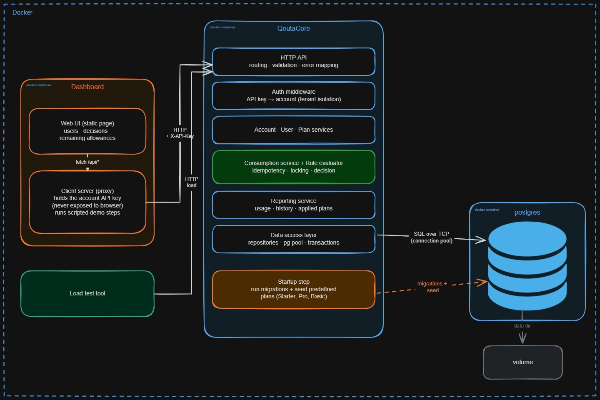
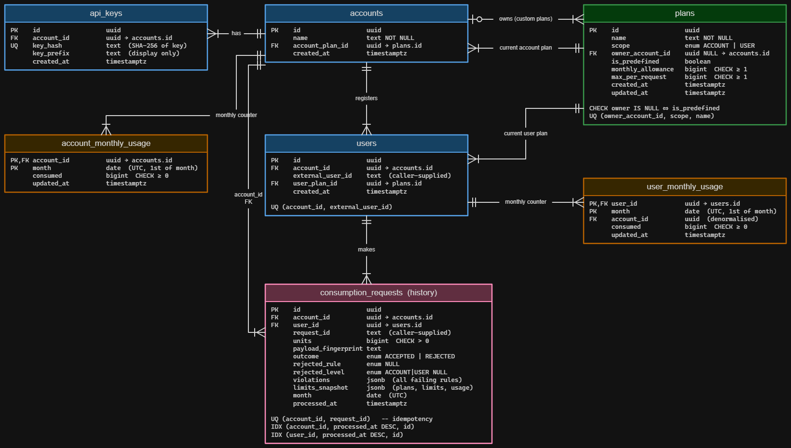

# Architecture

## Context

```text
Calling application ──HTTP, X-API-Key──▶ Metering service ──SQL──▶ PostgreSQL
(backend of a customer)                  (this project)
```

The service API is called **server to server** by other applications' backends. End users never authenticate directly
with the API and there is no end-user login. The included dashboard is an operator-facing Next.js client that calls the
API through its own server-side proxy. The API key identifies the calling **account**; the application names the
**user** in each request.

| Component                  | Responsibility                                                                                                                      |
| -------------------------- | ----------------------------------------------------------------------------------------------------------------------------------- |
| Metering service           | API, authentication, rule evaluation, accounting, history                                                                           |
| PostgreSQL                 | Durable state, idempotency (unique index) and concurrency control (row locks)                                                       |
| Example client / dashboard | Next.js client on port 3001. Its server routes keep the API key in an HTTP-only cookie and proxy authenticated requests to the API. |



## Code organisation

```text
src/
├── app.ts, server.ts, container.ts, api.routes.ts   composition and HTTP entry points
├── middleware/                                      API-key auth, validation, error handler, request logger
├── shared/                                          errors, logger, Prisma client, Prisma error mapper
├── helpers/                                         month (UTC) and cursor helpers
└── modules/
    ├── accounts/    account creation and the account's own plan
    ├── auth/        API-key generation, hashing and lookup
    ├── users/       user registration and plan assignment
    ├── plans/       predefined and custom plans
    ├── rules/       pure rules engine (no I/O)
    ├── consumption/ the consume transaction and request idempotency
    ├── usage/       monthly counters (locking, increments, reads)
    ├── history/     request history and pagination
    └── health/      liveness and database check
```

The dashboard lives separately under `client/`. Its `/api/session` route creates or validates a session, while
`/api/proxy/[...path]` forwards authenticated API calls using the key from the HTTP-only cookie. The browser therefore
does not send the API key directly to the QuotaCore API.

Each module follows the same flow:

```text
routes ──▶ controller ──▶ service ──▶ repository ──▶ PostgreSQL
 (HTTP)    (req/res)     (use case)   (queries)
```

### Rules

1. **Only repositories import the database client or run SQL.**
2. **Services own the transaction boundary.** A repository is created with the active database handle (the root client or a transaction client), so the same code works inside and outside a transaction.
3. **`rules/` is pure.** It imports nothing from Express, Prisma or other modules and does no I/O.
4. **Controllers contain no business logic.** They translate HTTP to a service call and back.
5. **The account comes only from the API key** (`req.account`), never from the URL or body.
6. **Modules talk through services**, not through each other's repositories. The one exception is read-side reporting, which reads tables the consume path writes.

## The consume flow

`POST /consume` is the core of the system. It runs as one database transaction:

| #   | Step                                                                                          | Failure                   |
| --- | --------------------------------------------------------------------------------------------- | ------------------------- |
| 1   | Authenticate the key (middleware) and validate the body                                       | 401 / 400                 |
| 2   | Find the user **inside the calling account**                                                  | 404 `NOT_FOUND_ERROR`     |
| 3   | **Claim the request id** by inserting a `consumption_requests` row (`ON CONFLICT DO NOTHING`) | already claimed: go to 3a |
| 3a  | Load the stored row. Same payload: **replay** the stored decision. Different payload:         | 409                       |
| 4   | Ensure this UTC month's usage rows exist (account, then user)                                 |                           |
| 5   | **Lock** the account usage row, then the user usage row (`SELECT … FOR UPDATE`)               |                           |
| 6   | Evaluate the four rules using the plans loaded for the account and user                       |                           |
| 7   | If accepted, increment both counters by the same amount                                       |                           |
| 8   | Finalize the request row: outcome, reason, all violations, and a snapshot of both levels      |                           |
| 9   | Commit (releases the locks) and return the decision                                           |                           |

Why this order:

- **Claim before lock.** A duplicate request waits on the unique index and then replays, so exactly one copy is processed.
- **Lock in a fixed order** (account, then user) in every request, so two requests can never wait on each other in a cycle.
- **Lock usage before evaluation**, so the counters used by the decision cannot change before commit. The account and user plans are loaded while finding the account-scoped user before the usage rows are locked.
- **Short transaction.** Locks are held until commit, so no network calls or slow work happen inside it.

## Data model

Seven tables: `accounts`, `api_keys`, `users`, `plans`, `account_monthly_usage`, `user_monthly_usage`,
`consumption_requests`. Plans are referenced by pointer, usage is a counter per owner per UTC month, and request rows
carry a snapshot of the limits that applied. The authoritative schema is [`prisma/schema.prisma`](../prisma/schema.prisma).



## Where each concern lives

| Concern                       | Mechanism                                                                                                 |
| ----------------------------- | --------------------------------------------------------------------------------------------------------- |
| Account isolation             | Account taken from the API key; every query is scoped by account id; other accounts' resources return 404 |
| Idempotency                   | Unique `(account_id, request_id)`                                                                         |
| Concurrent correctness        | Row locks in a fixed order, inside one transaction                                                        |
| Plan changes without redeploy | Plans are rows; services read them on every request                                                       |
| Past months                   | One usage row per owner per month; a new month is simply a new row                                        |
| Extensibility                 | A new rule implements the `Rule` interface and is added to the evaluator's ordered list                   |
