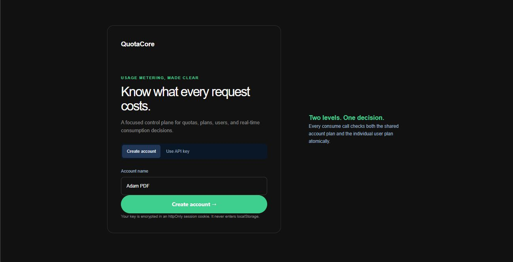
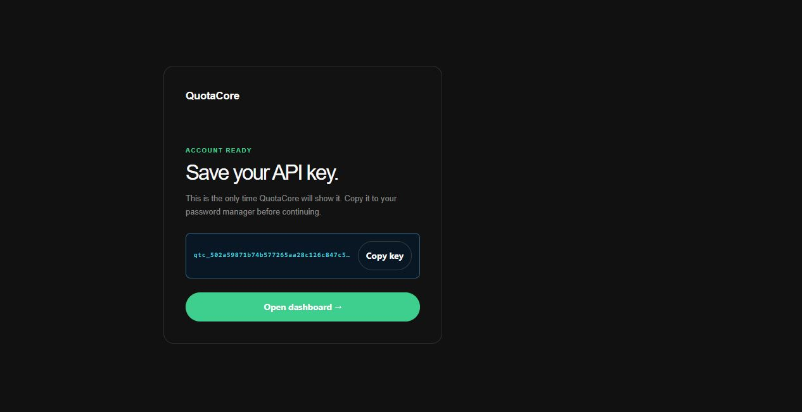
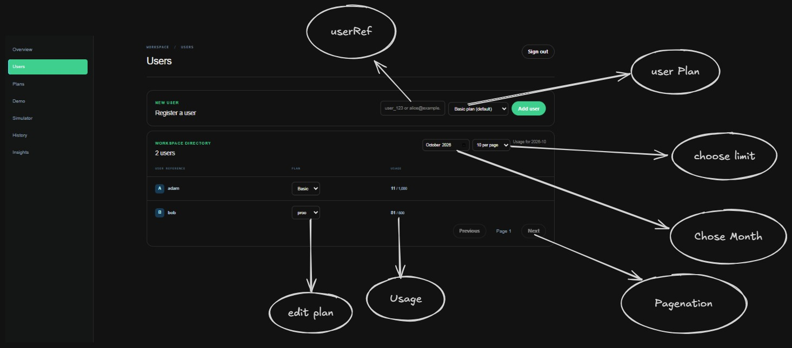
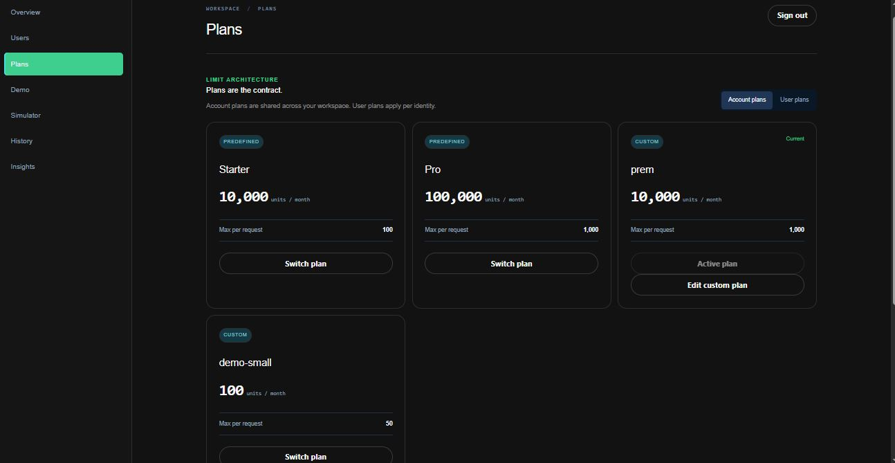
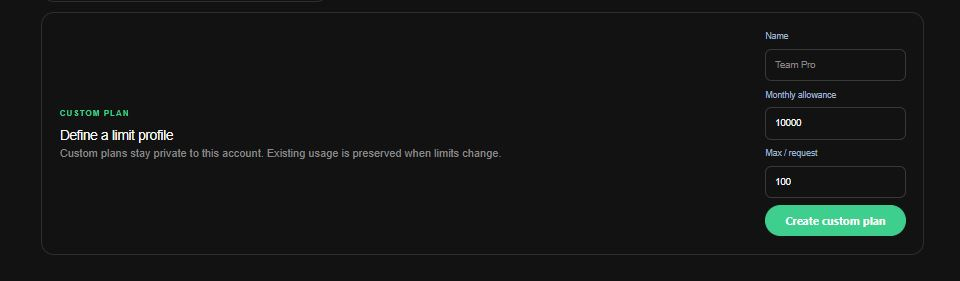
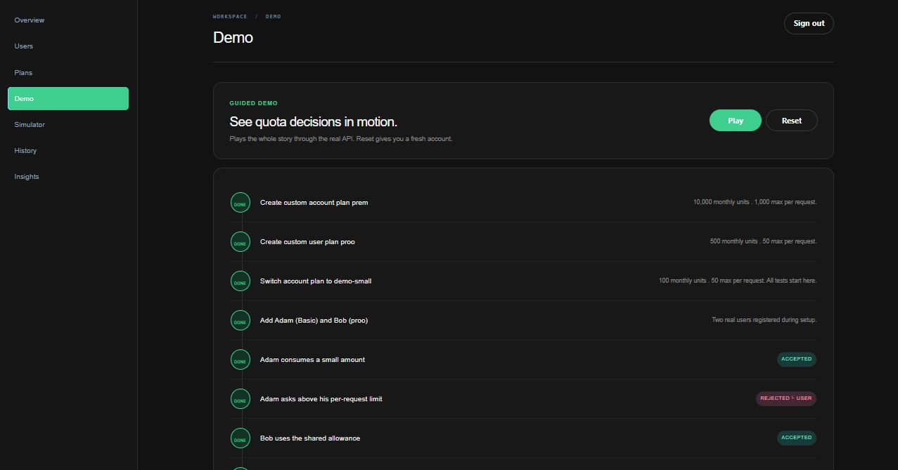
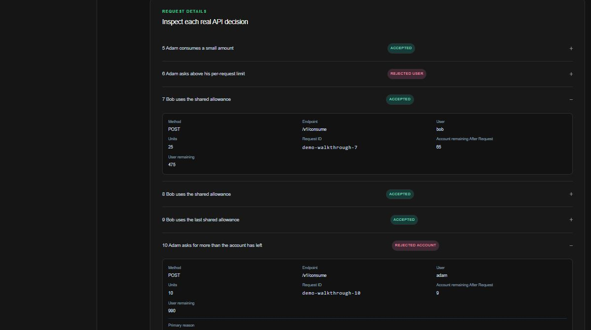
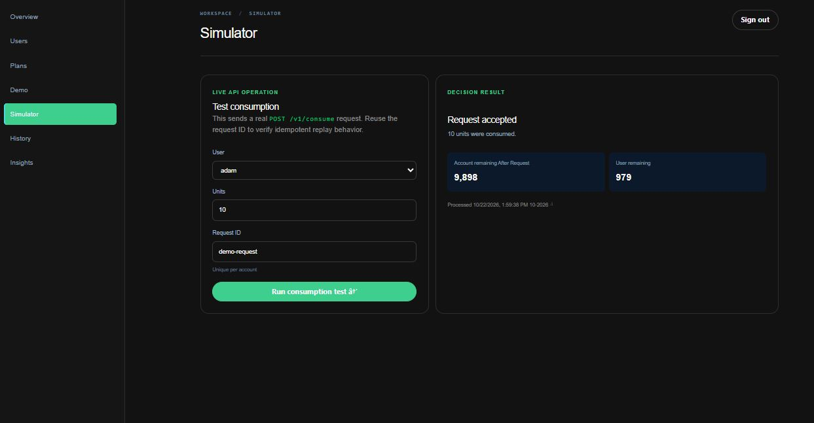
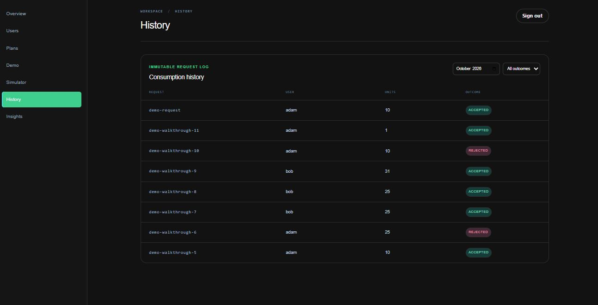
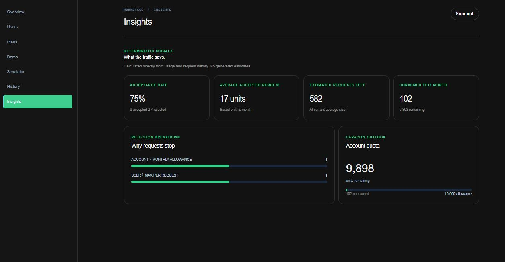

# QuotaCore Dashboard

The QuotaCore dashboard is a Next.js client for managing accounts, users, plans, usage, and consumption decisions through the QuotaCore API.

- Dashboard: [http://localhost:3001](http://localhost:3001)
- API: [http://localhost:3000](http://localhost:3000)
- Swagger UI: [http://localhost:3000/api-docs](http://localhost:3000/api-docs)
- API guide: [api-guide.md](api-guide.md)

## Start the dashboard

Start the API and PostgreSQL services first, then start the client:

```bash
docker compose up --build
```

Or run the client locally:

```bash
pnpm --dir client install
pnpm --dir client dev
```

The client runs on port `3001` and sends API requests through the Next.js proxy. The local client configuration is in `client/.env`:

```env
QUOTA_API_URL=http://localhost:3000/api/v1
```

## Sign in or create an account

The welcome screen supports two entry points:

- **Create account** creates an account through `POST /api/v1/accounts`.
- **Use API key** connects an existing account.

When a new account is created, the API key is displayed once. Copy it to a password manager before opening the dashboard. The client keeps the key in an HTTP-only session cookie and does not store it in `localStorage`.





## Dashboard sections

### Overview

The Overview screen summarizes the current account plan, remaining quota, active users, tracked requests, recent history, and account usage. It also provides a guided demo-data flow and shortcuts to the simulator.


### Users

The Users screen registers users, assigns user plans, shows each user’s current usage, and supports paginated user lists.



### Plans

The Plans screen lists predefined plans and account-owned custom plans. Predefined plans are read-only. Custom plans can be created with an account or user scope and can be updated later.





### Demo

The Demo screen creates or reuses demo data and sends real API requests so the accepted and rejected quota decisions can be inspected.





### Simulator

The Simulator sends a consumption request for a selected user and displays the resulting decision, including the accepted state, rejection reason, violations, and updated account/user limits.



### History

The History screen displays request-level decisions in reverse chronological order, including accepted/rejected outcomes, request IDs, users, units, reasons, and recorded usage snapshots.



### Insights

The Insights screen summarizes current-month traffic with acceptance rate, average accepted request size, estimated requests remaining, consumed units, and the most common rejection reasons.



## API behavior

The dashboard uses the same rules as the API:

- Account and user limits are evaluated together.
- A rejected consumption request returns HTTP `200` with `accepted: false`; it does not consume units.
- Reusing a `requestId` with the same payload replays the original decision safely.
- Reusing a `requestId` with different request data returns a conflict error.
- Errors use the API’s top-level response shape: `{ success, code, message, details? }`.

For the complete endpoint contract, see the [OpenAPI specification](openapi.yaml).
